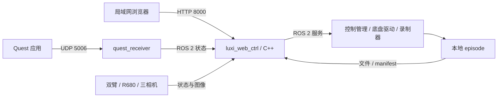

# LUXI 局域网控制台

参考原 `openarm_teleop/nodes/dora-openarm-data-collection-ui/.../templates/root.html` 的设备检查、相机预览和 episode 采集流程，实现独立 C++ ROS 2 HTTP 网关。浏览器使用原生 HTML/CSS/JavaScript，无 CDN、Node 构建或 Python 后端。原 `data_server` 已迁至本包的 `web_ctrl`，录制器与文件格式保持兼容。

## 页面与操作

- Quest：有效报文速率、左右追踪状态。收到有效遥操作报文才算连接，不用 ping 或头显 Wi-Fi 状态代替。
- 双臂：实际反馈是否新鲜、16 路反馈有效性、归位/对齐/遥操作状态；使能、暂停返回。
- R680：反馈连接、平移速度、电压、FlagStop、使能状态；启用和停车。托管模式由 Quest 双摇杆直接控制，握持键预留升降；网页不持续发送 Quest 模式速度。
- 三路 RGB：头部、左腕、右腕预览，尺寸、帧号、接收年龄与时间戳质量。过期画面隐藏，可单独暂停预览。
- 录制：任务说明、开始、成功/失败保存、取消并保留、样本数、质量检查、数据目录和磁盘空间。
- 数据清单：最近 30 个已提交 episode 的 manifest 链接；文件继续通过原 HTTP 下载接口及 `episode_pull` 回传。



按钮不绕过控制器门禁，成功与否以服务返回为准。启用双臂会触发归位；“暂停 / 返回”包含运动，不是硬件急停。服务失联后页面禁用操作并隐藏旧图像；HTTP 超时不自动重试运动指令。

## 编译与启动

在仓库根目录：

```bash
./tool/build.sh
# 模拟全系统；与开机服务使用不同 ROS 域和 HTTP 端口
ROS_DOMAIN_ID=76 ROS_LOCALHOST_ONLY=1 ./tool/run.sh mock:=true base_enabled:=true \
  http_host:=0.0.0.0 http_port:=18000 quest_port:=15006 \
  minimum_free_gib:=0.2 \
  "directory:=$PWD/data/mock"
```

访问 `http://板端IP:18000`，无需密码或令牌。模拟图像和反馈始终标为 MOCK。测试 Quest 应用应向 UDP 15006 发送；真实开机部署使用 UDP 5006。不要将两个模式接到相同 ROS 域。

## 开机自动运行

普通用户在仓库根目录执行一次：

```bash
./Project/luxi_web_ctrl/scripts/install_service.sh --hardware
```

安装 systemd 系统服务，无需桌面登录：

| 服务 | 行为 |
|---|---|
| `luxi-web.service` | 立即启动，之后每次开机启动；监听 `0.0.0.0:8000`。网页即使没有 CAN/Quest 也可打开 |
| `luxi-quest.service` | 随网页启动，独立监听 `0.0.0.0:5006/UDP`；不依赖 CAN，异常退出自动重启；网页停止/重启时同步停止/重启 |
| `luxi-robot.service` | 设置为下次开机启动，本次安装不启动硬件；先检查/配置 KH CAN，再启动真实双臂、R680 和录制器，复用常驻 Quest 接收节点，初始未使能、未录制 |

当前实机开机配置关闭三相机，因为正式海康 SDK 尚待验证。网页会显示“已关闭”，不会用假图代替；升降平台尚未接入。KH 缺失时机器人服务失败，网页继续运行并显示无反馈。接好后可手动 `sudo systemctl start luxi-robot.service`，不要同时运行手动的机器人实例。

只需要网页与 Quest 接收自启，可用 `--web-only`；此选项不修改已有硬件服务启用状态。明确关闭硬件自启用 `sudo systemctl disable luxi-robot.service`。

局域网浏览器访问：

```text
http://板端局域网IPv4:8000
```

查 IP：`ip -4 addr`。网页控制、设备管理和录制均不需要密码或令牌。2026-09-14 按操作员要求移除登录界面、后端鉴权、令牌文件读取和安装时的令牌生成；刷新后直接操作。能访问此局域网地址的客户端都可以提交控制请求；控制器仍检查设备反馈、输入状态和独立运动许可。网页无互联网资源依赖，HTTP 未加密。

```bash
systemctl status luxi-web.service luxi-quest.service luxi-robot.service
journalctl -u luxi-web.service -u luxi-quest.service -u luxi-robot.service -n 80 --no-pager
```

服务统一 `ROS_DOMAIN_ID=0`、`ROS_LOCALHOST_ONLY=1`：ROS 在板端进程间通信，浏览器和 Quest 仍走局域网 HTTP/UDP。手动 `tool/start_robot.sh --hardware` 会复用已运行的网页，不重复占用端口。`tool/start_robot.sh --mock` 在开机网页已运行时自动改用 ROS 域 76 / HTTP 18000 / UDP 15006。原 `tool/run.sh` 默认附带网页，如服务已启动须传 `web_enabled:=false quest_enabled:=false` 并使用同一 ROS 域。

停止之前先结束录制、底盘停车、双臂返回并确认 disabled，再执行：

```bash
sudo systemctl stop luxi-robot.service
sudo systemctl stop luxi-web.service
```

卸载自启：`sudo systemctl disable luxi-web.service luxi-robot.service`。不要在录制中直接关机。

## 接入相机

完成海康 SDK/序列号验证后，用 `sudo systemctl edit luxi-robot.service` 覆盖 `ExecStart`（先用空 `ExecStart=` 清除旧值），保留原命令其余参数并改为 `no_cameras:=false require_cameras:=true sdk_library:=绝对SDK路径`，必要时配置 `LD_LIBRARY_PATH`。同时修改 `scripts/run_web.sh` 的 `no_cameras:=false`，使页面配置与机器人一致；重启两项服务前先安全结束遥操作。不要只改网页配置而未真正启动相机。

## 代码与接口

| 位置 | 用途 |
|---|---|
| `src/web_ctrl.cpp` | C++ ROS 2 订阅/服务调用、状态新鲜度、请求校验、静态资源、文件回传 |
| `web/index.html` / `style.css` / `app.js` | 响应式中文操作台，桌面和手机布局 |
| `scripts/` | systemd 安装、独立网页启动、可选硬件 CAN 准备 |
| `test/http_probe.cpp` | C++ HTTP/ROS 集成验证：免密码访问、异常请求、设备过期和图像过期 |

保留 `/api/state`、`/api/cameras/{camera_id}`、`/api/episodes`、`/api/episodes/{id}/manifest`、`/api/files/{id}/{path}` 和 `POST /api/{control,base,episode}`。控制请求无需 Authorization 头，JSON 字段为 `command` 与 `detail`。`system.control_authorized` 为兼容现有客户端保留，始终为 true；它不代表电机已使能。新增 state 字段 `quest`、`cameras`、`system` 和各节点 `fresh`。

网页以单次请求完成后再轮询的方式刷新，状态约 2 Hz、图像最多约 3 Hz，避免慢网络请求堆积；录制器按其原采集频率独立运行。图像预览是 JPEG 快照，不宣称硬件曝光同步。最终仍只录制并回传，不训练。

## Quest 填写 IP 后如何接入

配套 Quest 遥操作 APK 与板端处于可互通局域网，目标 IP 填板端地址（当前 `192.168.3.179`），UDP 端口为 `5006`。应用保持发送时，网页显示接收频率和左右追踪状态；不需要连接 CAN 或使能机器人。这个协议是单向 UDP JSON，不提供 TCP/WebSocket/自动发现握手；普通网页和 Air Link 不能替代配套 APK。

网页服务启动即拉起接收服务，开机无需另开终端。检查命令：

```bash
systemctl is-active luxi-web.service luxi-quest.service
ss -lun 'sport = :5006'
sudo journalctl -u luxi-quest.service -n 30 --no-pager
```

常驻接收运行时，不再手动运行第二个 `quest_receiver`。独立 ROS launch 默认 `quest_enabled:=true`，复用常驻节点时需设为 false。域 76 的 mock 快捷启动仍自行监听 15006，不占用实际 Quest 的 5006。

## 手动动作设置与当前姿态保持

“动作设置”面板只保持本次双臂及夹爪姿态，不保存或重放动作，也不改电机零点、软件 offset 或关节限位。先支撑双臂和夹爪，再点击“进入动作设置（失能）”；手动摆放并停稳后点击“保持当前姿态”。驱动等待全部 16 轴的新鲜、限位内且稳定至少 300 ms 的反馈，然后以采样姿态预装目标、使能并立即保持，不返回 home 或启动姿态。编辑期间可以退出，退出仍保持失能；已保持时退出按钮不可用，避免误卸力。

接口复用 `POST /api/arm_startup`（ROS `/luxi/arms/startup`），请求 `{"command":"pose_enter|pose_hold|pose_cancel","detail":""}`。状态位于 `/api/state` 的 `arm_startup.manual_pose`，包含 `phase`（inactive/editing/preparing/holding）、`reason`、`generation`、`target[16]` 和 `can_hold`。保持是异步操作，HTTP 成功后应继续检查状态和实时关节反馈。

动作编辑/准备期间控制器停发旧目标，忽略 Quest 启动键和原生命周期使能；保持后可使用抬臂、网页/Quest 遥操作或原返回停车入口正常接管。控制器以本轮 `enable:<generation>` 交接，收到驱动确认后才推进运动目标；驱动拒绝旧使能和交接前的缓存目标。交接超时或被其他入口接管时，控制器停止本次启动/返回，不自动卸力。内部控制客户端若直接使用生命周期话题，也应先读取当前 generation，再发本轮带标识的 enable，确认驱动交接后再发新目标；不在手摆保持中时原 `enable` 字符串保持兼容。

刷新、关闭网页、失焦或断网不自动撤销双臂保持。重启或关闭双臂驱动仍会移除转矩，部署和维护前必须先可靠支撑机械臂。

保持中关节反馈失效或控制循环断档超过 150 ms 会锁存暂停状态（`manual_pose.fault_latched`），停止发送原保持目标，不自动卸力，也不在反馈恢复后自动重发。恢复新鲜反馈后需重新设置或明确启动正常控制接管，故障后的接管起点使用当前实测姿态。

## 指定关节角度动作

网页“关节角度控制”支持左右臂各 7 个关节和夹爪 J8，共 16 轴；反馈、原限位和目标同时显示弧度 rad 与角度 °，弧度优先排列，使用当前标零坐标。每个关节的两种目标输入自动联动，编辑任一单位会换算到另一单位；发送统一使用弧度字段，不因显示取舍损失精度。先读取当前角度，修改所需关节后点击“执行目标姿态并保持”。读取和编辑不使能、不运动；执行为单次有限动作，默认速度上限 0.15 rad/s，可设 0.02–0.2 rad/s，仍受原各轴速度限制。全部关节按共同进度缓慢到达目标，由实测位置及速度连续确认到位后保持。停止按钮中止动作并保持最后发送的姿态，不执行回零；准备阶段尚未使能时取消则保持未使能。已接受的动作不依赖网页持续连接，关闭页面不会取消。

限位直接来自驱动加载的原配置，未改配置、零点或 offset。输入越界、长度错误、非数字、非有限值、单位或速度错误时整组拒绝，绝不把越界输入裁剪后执行。当前实测姿态也必须在原限位内，且 16 轴反馈有效、停稳，才能接受新动作。执行期间忽略旧生命周期使能和旧遥操作目标；反馈异常、超限反馈、跟随误差、到位超时或控制循环中断会中止，不会因恢复反馈而自动续跑。单关节限位不等于双臂/机身/环境碰撞检测，执行前须确认运动空间。

接口复用 `POST /api/arm_startup`，外层 JSON 的 `detail` 是 JSON **字符串**。`joint_move` 的 detail 为 `{request_id: "客户端生成的唯一标识", unit: "rad", positions: targetRad, speed_rad_s: 0.15}`；`positions` 必须是 16 个有限数字，顺序为右 J1–J8、左 J1–J8。`unit` 支持 `rad` 或 `deg`，省略时优先按 `rad`；`positions` 的单位由 `unit` 明确指定。角度制会先严格校验角度边界，再换算为弧度按原始限位复核；反馈、目标状态和限位仍统一为 rad，速度仍为 rad/s，省略为 0.15。最近 256 个已接受 request_id 去重：相同 ID/目标不重复执行，相同 ID 配不同目标拒绝；执行下个动作须换新 ID。`joint_stop` 无需 detail，重复调用不重新使能、不清除故障。

例如控制端可构造 `JSON.stringify({command:'joint_move', detail:JSON.stringify({request_id:uniqueId, unit:'rad', positions:targetRad, speed_rad_s:0.15})})` 作为请求体。使用角度制时将 `unit` 设为 `deg`，并在 `positions` 中传入角度值；一次请求只传一组带单位的目标。请求成功只表示已接受，应继续读取 `/api/state` 的 `arm_startup.joint_control`：`phase` 为 idle/preparing/moving/ready/stopped/fault，包含 `request_id`、`target[16]`、`speed_rad_s`、`reason`，以及原 `lower[16]`/`upper[16]` 限位。只有 `ready` 且全部关节反馈正常、已使能时才表示到位保持。完成或停止后，原抬臂及遥操作入口可显式接管。

关节动作执行期间，原控制器的 stop/park/disable/halt 以及 Quest B / X 的新按下操作也中止本次关节动作并保持，不直接回零或卸力；停止后再次通过原返回入口可执行原停车流程。停止消息带本轮 generation，旧消息不能中断下一轮动作。明确移除转矩仍使用 OpenArm 面板的“撤销使能”。

## 多控制端交接与连续保持

手动姿态保持、指定关节目标、抬臂保持和 ROS 控制之间交接时，驱动保留最后实际发送的支撑目标；已经使能时不重复发送电机使能。新控制端尚未发来新目标时，在全部关节反馈有效且原支撑目标在原限位内的前提下，驱动继续发送该目标，不因普通指令间隙自动失能。新目标仍按原限位和速度约束执行。接口参数错误整组拒绝，失败交接不会走原持有者的卸力清理路径。

`POST /api/control`（ROS `/luxi/control`）的 `disable`、`halt`、`hold` 在独立和统一模式下均表示停止控制意图、保持转矩，控制端切换时可使用 `hold`，无需先撤销电机使能。`start` 可从这种 hold 状态重新接管。`stop`/`park` 的既有返回停车流程仍是显式返回并失能；切换控制端不应使用返回停车作为断开连接操作。明确卸力使用 `POST /api/arm_startup` 的 `{"command":"disable","detail":""}`，或网页 OpenArm 面板的“撤销使能”。进入手动摆姿同样是明确失能操作。

驱动状态增加 `control_generation`（当前控制归属）、`support_target[16]`（实际支撑目标，rad）、`output_enable_count` 和 `output_disable_count`（驱动请求电机组使能/失能的累计次数）。内部生命周期话题的失能命令必须为 `disable:<control_generation>`，旧归属或无归属的 `disable` 不执行。控制器的显式停车流程在接管确认后保存本次归属，完成时只撤销这一次归属；过期停车消息不能卸掉后来建立的保持。旧 ROS 客户端应改用普通 hold 或上述明确卸力服务。

以上保证适用于此 SDK 的 HTTP/ROS 接口正常交接。电源断开、电机保护、CAN 故障以及驱动进程退出不属于控制权交接；重启驱动仍会卸力，必须先可靠支撑并停止保持。不要让另一个程序绕过驱动直接写同一 CAN 总线。

## 双臂静态位置误差补偿（夹爪除外）

静态位置补偿统一在 OpenArm 驱动输出层执行，覆盖上电抬臂及到位保持、手动姿态保持、指定关节角度和 ROS/遥操作的稳定目标。只启用右 J1–J7、左 J1–J7，共 14 轴。右/左 J8 夹爪补偿始终为零，保持原有位置/力控、增益和夹持力设置。

驱动将名义目标与实际电机支撑目标分开：输出为名义角度加缓慢学习的静差补偿，并受原始关节限位及原各轴速度限制。目标稳定、速度低于 0.08 rad/s、全部反馈有效且误差不超过 0.25 rad 时，等待至少 300 ms 后按位置误差积分；死区 0.003 rad，增益 0.5/s，单轴偏置不超过 ±0.2 rad，学习速度不超过 0.03 rad/s，指定动作速度更低时继续按更低速度限制。靠近原限位时，积分只允许使用剩余空间，防止积分饱和；边界裁剪优先于偏置学习，实际电机输出仍受原轴速度和本次动作速度限制。运动、反馈异常、较大跟随误差和返回停车过程中停止学习，保留或按原保护逻辑暂停已有支撑输出；明确失能后清零。补偿不修改编码器反馈、零点、offset 或配置限位，也不是基于连杆质量模型的重力前馈。

API 的请求角度和反馈角度仍为实际逻辑关节角度。状态 `arm_startup.nominal_target[16]` 是未经静差补偿的名义目标，`support_target[16]` 是实际发送的支撑目标，`static_compensation_rad[16]` 是补偿偏置，`static_compensation` 给出启用范围及限幅参数。控制权交接保留已有偏置，控制器从名义目标续接，避免重复叠加补偿或突然丢失支撑。无外部新目标时，仍保持原名义姿态及其补偿。
