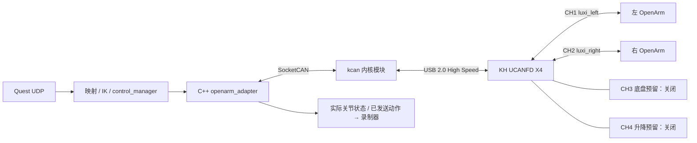

# KH-UCANFD-B2B-X4 适配

本目录保存核心适配配置和依赖指纹。用户提供的 ZIP 保留在 `SDK/`，被 Git 忽略；外部驱动展开和编译在 `build/kh-sdk/`，无 Git 子模块。驱动是厂商 GPL C 内核代码，本项目新增应用逻辑为 C++17。



## 已确认的本机条件

- USB VID:PID `395e:0020`，USB 序列号 `KCANX4WCID001`。
- Ubuntu 22.04 ARM64，内核 `6.1.83`；匹配头文件在 `/usr/src/linux-headers-6`。
- 原有 `can0` 属于 SPI `m_can`，不是这个 USB 模块。
- `KH-UCANFD_Linux_SDK-1.4.2.zip` 只有文档；`KH-UCANFD_Linux_SDK.zip` 才有厂商驱动源码。指纹见 `repositories.lock`。
- 设备序列号可能是厂家统一字符串；多块同型设备若序列号相同，工具拒绝歧义，需先配置唯一设备身份。

## 编译和加载

在仓库根目录执行：

```bash
./tool/build_kh_driver.sh
# 临时加载本次编译结果；重启后失效，不安装厂商 udev 或更改其他驱动。
sudo modprobe can
sudo modprobe can_raw
sudo modprobe can_dev
sudo insmod build/kh-sdk/KH-UCANFD_Linux_SDK-1.4.2/driver/kcan.ko
```

脚本校验 ZIP SHA256、检查内核版本，把头文件复制到 `build/kernel-6.1.83/` 后编译缺少的宿主工具，再编译内核模块。不要用不同版本内核的 `.ko`。驱动变更、内核升级后重新构建。日志在 `log/kh-*.log`。厂商一键安装会修改系统驱动和规则，本项目不自动执行该脚本。

## 四路配置及 OpenArm 接入

`channels.json` 使用零起始驱动通道号 `0..3` 对应外壳 CH1..CH4，配置工具从 `/sys/class/kcan/*/{ctrlr_number,ndev}` 和 USB 父设备读取对应关系，不把内核分配顺序当作物理通道。

| 外壳通道 | 驱动编号 | 稳定接口名 | 用途 | 默认配置 |
|---|---:|---|---|---|
| CH1 | 0 | luxi_left | 左臂 | CAN FD，1M/5M |
| CH2 | 1 | luxi_right | 右臂 | CAN FD，1M/5M |
| CH3 | 2 | luxi_base | 底盘预留 | 不启用 |
| CH4 | 3 | luxi_lift | 升降预留 | 不启用 |

1M/5M 是沿用现有 OpenArm FD 工作方式的配置值，实际电机固件必须匹配；经典 CAN 设备应设 `fd:false` 并同步修改机械臂配置。底盘、升降的参数仅是占位，启用前按后续协议设置。图一和图三的 CH3/CH4 排列不同，这里统一采用图一，不在此阶段实现其协议。

```bash
# 编译 ROS 应用后，查看枚举和配置计划，不改变接口。
BIN=build/install/luxi_device_adapters/lib/luxi_device_adapters/kh_can_setup
$BIN
$BIN device/KH-UCANFD-B2B-X4/channels.json
# 只监听：控制器不发送数据、不 ACK，可用于被动检查。
sudo "$BIN" device/KH-UCANFD-B2B-X4/channels.json --listen
ip -details -statistics link show luxi_left
# 关闭本模块四路接口。
sudo "$BIN" device/KH-UCANFD-B2B-X4/channels.json --down
```

确认接线、终端电阻、通道标签与电机速率后，以正常模式配置；此操作启用 CAN 控制器及 ACK，但工具本身不发送应用数据帧：

```bash
sudo "$BIN" device/KH-UCANFD-B2B-X4/channels.json --apply
./tool/run.sh mock:=false allow_hardware:=true \
  "config:=$PWD/Project/robot_bringup/config/arms-kh.json" \
  no_cameras:=true require_cameras:=false
```

运行时控制器默认 disabled；后续启动/对齐由 Quest 或服务明确触发。真实相机启用需同时提供海康 ARM64 SDK。不要在机械臂节点运行时更改接口配置。配置工具遇到命名冲突、通道缺失、重复序列号会拒绝；`ip` 中途失败可能留下部分配置，需要检查后重新执行，不能认为四路设置是原子操作。

## 数据与故障

USB 模块负责传输，机械臂协议仍由固定版本 `openarm_can` 编解码。驱动接收实际电机反馈 → `ArmState`；仅发送成功的命令发布到 `/luxi/applied`，发送成功不代表电机已完成动作。录制器保留两者及时间戳，便于后续分析。USB 拔出、反馈过期、发送失败进入现有故障/保持流程；不自动恢复运动。CAN `restart-ms=0`，不会在 bus-off 后未经检查自动恢复。

实机运动、四路接线和跨设备总线通信需单独验收。本次具体加载、枚举与测试结果见 `docs/编译与测试记录.md`。

## 可重复的软件收发验证

`bash tool/test_socketcan.sh` 创建专用 `luxi_test_can` 虚拟接口，运行 C++ `socketcan_probe`，验证固定 OpenArm SDK 的经典 8 字节帧和扩展 ID、64 字节 CAN FD 帧双 socket 往返，退出时删除虚拟接口。不会复用现有接口，也不会发送到 USB 模块。此项证明用户态 SocketCAN API 链路，不证明实物收发与接线。

配置实物为 `--listen` 后，可运行 `socketcan_probe --listen luxi_left` 或 `luxi_right` 验证接收 socket 打开和轮询；没有总线数据时输出 `observed frames=0`，不能当成电机反馈验证通过。

驱动构建工具还依赖系统 `make/gcc/flex/bison/libelf-dev/bc` 和匹配的已配置 ARM64 内核头文件。内核模块目前仅临时加载；开机自动加载、上电运动和自动启动配置均未启用。
