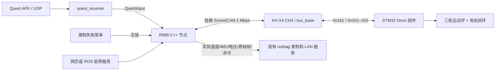

# R680 三轮全向底盘驱动

本次实现是 **RDK/Linux 上的 C++ ROS 2 驱动**，不修改、不烧录 STM32 固件。依据本目录的 V1.0 CAN 协议与 `WHEELTEC_C50X_2026.05.29` 源码。厂商 ZIP、DOCX、PDF 原样保留并被 Git 忽略，确切 SHA256 见 `repositories.lock`。厂家未提供上游 Git 地址，当前以本地交付文件和内容指纹追踪，不虚构仓库链接。

源码在 `Project/device_adapters/`：

- `include/luxi/r680.hpp`：协议编解码、三帧组包、PS2 摇杆映射、启停与超时状态机。
- `include/luxi/r680_socket.hpp`：独占 SocketCAN、标准帧过滤、内核接收时间戳、发送检查。
- `src/r680_adapter.cpp`：50 Hz 控制、20 Hz 底盘反馈、ROS 发布、Quest 接入、退出零速。
- `test/test_r680.cpp`：协议黄金向量与异常、摇杆方向、超时及互锁测试。
- `test/r680_integration_probe.cpp`、`r680_socket_probe.cpp`：ROS mock 链路和专用 vcan 收发验证。

## 架构和 STM32 分工



固件 `BALANCE/can_callback.c` 的 `0x181` 分支直接接收车体 Vx、Vy、Vz；这里 Vz 是 Wz 偏航角速度。`balance_task.c` 调用 `Drive_Motor` 完成车型相关运动学；`data_task.c` 将 24 字节反馈拆成 0x101、0x102、0x103。主机不重复计算三轮转速，不发送轮电机 PWM。

必须已运行 OMNI_CAR 对应固件；压缩包同时包含多车型内容，不能因为文件夹中存在 Akm_Car.hex 就将其烧录到 R680。源码中还存在上电自检运动，以及取决于 SecurityLevel 的命令丢失逻辑。因此本机发送零速不等于能够阻止所有固件自主行为。

## Quest 控制方式与已有用途

默认按 PS2 模拟摇杆分工：左手平移，右手转向。Quest 不具备 PS2 那样的独立方向十字键。X 仅控制双臂，Y 切换底盘许可，A/B 用于录制工作流；这些按钮不作为车体方向键。下述 X/Y 映射已构建并通过隔离软件测试；未重启实机服务，新映射下次启动生效，尚未进行实机按键验证。

| 输入 | 当前原有功能 | 新增底盘行为 |
|---|---|---|
| 左摇杆上下 lsy | 失败原因菜单选项 | 前进/后退；菜单打开时底盘禁止运动 |
| 左摇杆左右 lsx | 未用于运动 | 右拨右移、左拨左移 |
| 右摇杆左右 rsx | 未用于运动 | 右拨顺时针、左拨逆时针（前进/静止时） |
| 右摇杆上下 rsy | 未用于运动 | 暂不分配 |
| 左/右侧握持键 lg/rg | 预留升降下/上，硬件未接入 | 托管模式无需握持；仅 `require_left_grip=true` 时需按住左握持键 ≥0.7，松开即零速 |
| 左/右食指扳机 lt/rt | 双臂对齐与夹爪 | 保留，不作为底盘油门 |
| X | 仅机械臂启停/返回 | 不改变底盘许可或摇杆运动 |
| Y | 底盘许可切换，不再取消录制 | 短按请求启用；已启用时按下停车并撤销许可，长按仅切换一次 |
| B | 失败菜单 / 暂停退出 | 按下同时撤销底盘许可 |
| A | 开始/确认录制 | 保留；底盘没有额外绑定 |

默认参数：死区 0.16（接近 PS2 的 20/127）、平移最大 0.2 m/s、转向最大 π/10 rad/s。对平移向量总模长限幅；行驶时限制加速度，松开握持键/失联/停止绕过斜坡立即下发零速。零速是命令，不保证车辆瞬时物理刹停。

**PS2 倒车转向细节**：原 `PS2_control()` 对非阿克曼车型执行 `if(Vx<0) Vz=-Vz`。默认 `base_ps2_reverse_steering:=true` 保留它，因此倒车时左右转向符号与静止时相反。若希望全向车始终按右拨顺时针控制，启动时设置 `base_ps2_reverse_steering:=false`。

启用底盘可短按 Y、使用独立 `/luxi/base/control` 服务或网页“启用 Quest 底盘控制”按钮。启用必须具备有效 Quest/底盘反馈、摇杆回中、失败菜单关闭且 FlagStop=0。托管模式 `require_left_grip=false`，直接用摇杆；独立启动默认 `require_left_grip=true`，启用时需松开左握持键，行驶时按住。启用被拒绝或断流/故障后需要松开 Y 再按，不能按住等待或靠网络恢复自动继续。B 停车优先于同时按下的 Y；X 始终只控制双臂。

## CAN 协议

| 项目 | 配置 |
|---|---|
| 物理口 | KH X4 CH3（驱动通道 2），luxi_base |
| 总线 | **经典 CAN 2.0，1 Mbps，fd off，MTU 16** |
| 主机发送 | 仅标准 ID 0x181，DLC 8，50 Hz |
| 命令字节 | BE16(Vx×1000)、BE16(Vy×1000)、BE16(Wz×1000)、00、00 |
| 主机接收 | 0x101 → 0x102 → 0x103，三帧各 8 字节，约 20 Hz |
| 整包 | 24 字节，头 0x7B，尾 0x7D；0..21 字节 XOR 等于字节 22 |
| 缩放 | 速度 /1000；加速度 /1671.84；陀螺 /3754.9；电压 /1000 |
| 时序 | 三帧跨度 ≤20 ms；Quest 命令超时 200 ms；反馈延迟 >100 ms 下发零速，>250 ms 撤销许可 |

扩展帧、RTR、长度错误、错序、重复中间帧、超时、错误校验整组丢弃，不发布半更新状态。收到新 0x101 会重开一组。反馈无设备序号和 STM32 时间戳，因此时间窗口与 XOR 不能从理论上完全识别所有混包，原始帧和接收时间保留供复核。

接收 socket 保留 SO_TIMESTAMPNS 的内核墙钟时间，并换算为主机单调到达时间；不能用出队时刻给排队的旧帧刷新寿命。检测到时间倒跳会撤销许可。CAN 错误和写入失败不会发布伪成功命令。Socket 独占锁与 OpenArm 使用同一机制，不能与旧控制器/PS2/APP 同时发送运动命令。

## 运行

先在仓库根目录编译及测试：

```bash
./tool/build.sh
./tool/test.sh
./tool/test_r680_socketcan.sh
```

完整系统的 mock 模式（不打开任何实物 CAN）：

```bash
./tool/run.sh mock:=true base_enabled:=true minimum_free_gib:=0.2
```

网页默认 `http://127.0.0.1:8000`，先将 Quest APK 指向板端 UDP 5006。保持摇杆回中、左握持键松开，再点“启用底盘”。也可使用：

```bash
source build/install/setup.bash
ros2 service call /luxi/base/control luxi_interfaces/srv/Command "{command: start, detail: ''}"
ros2 service call /luxi/base/control luxi_interfaces/srv/Command "{command: stop, detail: ''}"
```

如只调试底盘，可独立启动 Quest 接收器和 R680 节点，不需要机械臂反馈：

```bash
# 终端 1
ros2 run luxi_quest_receiver quest_receiver
# 终端 2：默认 mock；显式实机参数见下文
ros2 run luxi_device_adapters r680_adapter --ros-args -p mock:=true
```

实机准备：参考 KH 模块 README 加载 kcan，确认 CH3 接 R680，并使用新配置文件。该配置保留两臂 FD，CH3 经典 CAN，CH4 升降关闭。执行配置前停止全部设备控制节点，它会重新配置前三路接口。

```bash
BIN=build/install/luxi_device_adapters/lib/luxi_device_adapters/kh_can_setup
$BIN device/R680/channels-r680.json
# 核对接线和速率后执行正常通信配置
sudo "$BIN" device/R680/channels-r680.json --apply
# 仅启动真实底盘，机械臂无须启动
ros2 run luxi_device_adapters r680_adapter --ros-args \
  -p mock:=false -p allow_hardware:=true -p interface:=luxi_base
```

整机带真实底盘时，使用 `base_enabled:=true`；`base_mock` 默认跟随 `mock`。例如保持双臂与相机为 mock 而底盘使用实物：

```bash
./tool/run.sh mock:=true base_mock:=false base_enabled:=true allow_hardware:=true
```

主机节点启动即周期发送零速以取得 CAN 控制来源，但默认没有非零运动许可。真实运动首次验收需架空车轮确认各方向，CAN 无 ACK，发送成功不能当作机械执行成功。正常退出尝试发 10 帧零速，间隔 20 ms；SIGKILL、断电、USB 拔出时主机无法保证送达，需依赖现场硬件停止措施与经验证的下位机停机逻辑。本轮不自动执行实机启动命令。

## 录制与 LAN

| 话题 | 类型 | 内容 |
|---|---|---|
| /luxi/base/state | std_msgs/String，JSON r680_v1 | 编码器车体速度、IMU、电压、FlagStop、三帧单调时间、mock 标记 |
| /luxi/base/applied | std_msgs/String，JSON r680_command_v1 | 实际提交的量化速度、CAN 字节、Quest 源时间、发送时间、许可及原因 |
| /luxi/base/can_rx | std_msgs/String，JSON | 原始 CAN ID、8 字节、DLC、内核墙钟和单调接收时间 |
| /luxi/base/status | std_msgs/String，JSON | 许可、反馈新鲜度、解析成功/错误计数 |
| /base/velocity | geometry_msgs/TwistStamped | 车体坐标系实际 Vx、Vy、Wz |
| /base/imu | sensor_msgs/Imu | 无姿态估计的加速度和角速度；orientation_covariance[0]=-1 |
| /base/battery | sensor_msgs/BatteryState | 电压；无电流/容量信息，用 NaN 表示未知 |

现有录制器保存上述四个 `/luxi/base/*` JSON 话题，完整物理量均已包含其中。HTTP `/api/state` 增加 base 和 base_status，并根据原始时间重新检查反馈有效性；`POST /api/base` 支持 start/stop，沿用控制令牌规则。JSON 字段不会自动成为 ROS 强类型消息的成员，消费方需按 schema 解析。

既有 samples.jsonl 仍是 16 维双臂视图。此阶段不填充升降假数据，不将底盘异步反馈直接拼进旧向量；待升降接入后再统一定义完整 21 维样本时间对齐。底盘位置没有真值输出，本轮也不声称完成里程计/定位。现有录制开始条件仍要求双臂反馈；独立底盘测试可用 rosbag2 订阅上述底盘话题。

## 验证记录

本次本地编译、单元、ROS mock 和虚拟 CAN 结果见 [R680 验证记录](../../docs/R680编译与测试记录.md)。真实底盘方向、实际速度、急停和断电停车仍需现场验收。


## CAN3 实机检查与网页键盘控制（2026-09-11）

网页新增独立 WASD 测试，限速 0.05 m/s，带松键停车、失焦撤销及 200 ms 服务端看门狗。驱动新增 `receive_only:=true` 用于无发送诊断，并向网页发布接口、输入来源及诊断模式。首次 CH3 检查无反馈且出现 BUS-OFF；重新接线并共地后，52 秒复测接收 1043 组有效反馈、无新增 CAN 错误，网页已反馈在线。当前真实节点周期零速、未使能，未进行非零方向验收。接线检查与测试记录见 [CAN3 实机检查](../../docs/R680_CAN3实机检查.md)。
