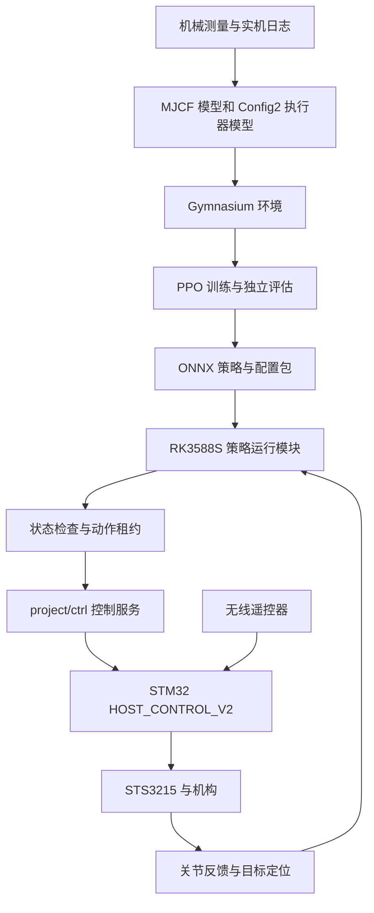

# 挖机玩具仿真强化学习与真机部署实施路径

日期：2026-10-16。适用对象：Config2 七舵机挖机、STM32F103C8T6 主控和现有 RK3588S Linux 上位机。

建议先完成一个可验证的闭环：**测量和标定机构 → 在 MuJoCo 中复现机械结构与 Config2 控制行为 → 使用 PPO 训练固定底盘的末端到点任务 → 导出 ONNX → 在 RK3588S 上通过现有控制服务运行 → 再扩展抓取搬运、回转和履带移动**。

这里的“导入仿真”包括几何、关节、质量、执行器、观测和通信行为。只有外观模型不足以进行可靠的仿真到真机迁移。首版以夹爪到点和轻物块搬运为目标；真实挖土需要另外建立土壤接触和负载模型。

本页给出待实施方案。仓库已有串口控制、视觉和板端推理基础，但仿真资产、训练环境、策略模型及策略运行模块需要新增。

## 现有条件与首版范围

### 可以直接复用的能力

| 项目 | 当前情况 | 在训练和部署中的作用 |
| --- | --- | --- |
| 控制硬件 | STM32F103C8T6、七个 STS3215 舵机 | 执行运动、校验限位、处理来源仲裁和失联停止 |
| Linux 上位机 | RK3588S，现有 aarch64 C++ 与 Qt 工程 | 采集观测、运行策略、记录日志 |
| 主机协议 | `HOST_CONTROL_V2`，七通道方向输入 | 首版策略的实际动作接口 |
| 控制服务 | 仓库根目录 `project/ctrl`，Unix socket，共用串口连接 | 策略接入入口，避免与 Qt 争抢串口 |
| 位置反馈 | `STATUS2` 和 `READINGS` | 提供关节编码器读数，需要补齐采样时间和有效性 |
| 图像与推理 | USB 摄像头、YOLOv8n、ONNX Runtime CPU 后端 | 复用采集和推理基础，另做目标三维定位 |
| 下位机约束 | Flash 限位、小步更新、反馈领先窗口、无线优先、约 200 ms 主机失联停止 | 在仿真中建模，在真机上继续保留 |

坐标与准备流程以 [Config2 控制说明](config2_control.md)、[配置文件](../config/config2.json) 和当前源码为准。Linux 接口见 [本体控制模块](../../../../../../project/ctrl/README.md)，视觉链路见 [视觉模块](../../../../../../project/vision/README.md)。[舵机替换评估](servo_replacement_assessment.md) 包含旧阶段的运动禁用和速度描述，不作为当前控制规格。

### 七个通道的实际含义

`HOST_CONTROL` 顺序固定为 `[left, right, swing, boom, arm, pitch, gripper]`。

| 功能 | 舵机 ID | 固件轴索引 | 当前控制方式 | 参考坐标范围 | 通道为正时的编码器方向 |
| --- | --- | --- | --- | --- | --- |
| 大臂 | 1 | 0 | 位置目标递增 | 1001..2950 | 减小 |
| 小臂 | 2 | 1 | 位置目标递增 | 2223..4076 | 增大 |
| 夹爪俯仰 | 3 | 2 | 位置目标递增 | 1547..3609 | 增大 |
| 回转 | 4 | 3 | 连续轮式速度 | 无位置限位 | 正速度方向，机械方向需标定 |
| 左履带 | 5 | 无位置轴索引 | 连续轮式速度 | 无位置限位 | 总线速度为负，安装方向反转 |
| 右履带 | 6 | 无位置轴索引 | 连续轮式速度 | 无位置限位 | 总线速度为正 |
| 夹爪开合 | 8 | 4 | 位置目标递增 | 172..1292 | 增大 |

**当前通道幅值不等于可连续调节的速度。** 履带输入范围为 -6..6，其他为 -10..10，但 Config2 主要按符号执行：履带固定 3000，回转固定 1000，四个位置轴使用 250/500/200/200 的速度参数。位置目标名义上每 20 ms 更新 5/10/4/4 个计数，单次最多 10。实际角速度受舵机闭环、负载及总线时序影响，不能直接把这些参数当成 rad/s。

位置轴还会根据新鲜反馈限制目标领先，驱动层窗口上限为 96 计数；松开或反向会先保持新读数。首版仿真必须实现这些行为，不能把策略输出直接接到无限力矩的位置控制器。

### 首版任务定义

首个里程碑选“固定底盘、固定回转、固定夹爪开度，控制大臂、小臂和俯仰，让夹爪参考点到达工作平面内的目标位置”。目标限制在已标定的可达区域，先只训练位置，随后再加入工具俯仰角要求。

锁定回转后，三轴主要在一个平面内运动，不能要求覆盖任意三维目标。首版可以保存三维误差向量，但目标采样必须落在该平面附近。夹爪开合暂时保持，后续抓取阶段才放开。

真机对应使用夹具固定底盘与回转结构；轮式回转的零速度指令不提供可靠的绝对位置锁定。夹具、支撑条件及其对机构运动的影响也应与仿真任务一致。

这样能够先验证编码器转换、运动学、动作映射和通信延迟。进入自由三维到点时，再引入具有可靠角度反馈的回转轴。

## 仿真平台和运行架构

### 首选 MuJoCo 与 Gymnasium

| 方案 | 适用阶段 | 对本项目的选择 |
| --- | --- | --- |
| MuJoCo + Gymnasium + Stable Baselines3 | 小机构动力学、接触、快速训练验证 | 首版主线；先采用低维状态策略 |
| Isaac Sim + Isaac Lab | 需要复杂视觉场景、大规模并行或已有 NVIDIA 训练工作站 | 后续评估，增加模型和计算环境维护成本 |
| Gazebo + ROS 2 | 需要对接现成 ROS 2 驱动、导航与机器人系统集成 | 可作为后续集成环境，首版不必引入 |

MuJoCo 原生使用 MJCF，也可以读取 URDF。URDF 导入后仍要补充执行器、接触和约束等信息；本项目直接维护 MJCF 主模型更便于迭代，确有 ROS 2 需求时再维护 URDF 导出。[MuJoCo 建模文档](https://mujoco.readthedocs.io/en/stable/modeling.html#urdf-extensions)

训练放在开发 PC 或远程训练机。首版低维 MLP 策略可以先用 CPU 做小规模 PPO 实验，是否使用 GPU 由实测吞吐决定。RK3588S 承担部署推理和传感，不作为 Isaac Sim 训练主机；Isaac Sim 当前公布的 aarch64 支持设备并不包含 RK3588S，选用时需按官方要求配置兼容工作站。[Isaac Sim 系统要求](https://docs.isaacsim.omniverse.nvidia.com/latest/installation/requirements.html)

### 训练与真机共用观测和动作定义



策略只输出允许的运动方向；主机监督模块检查观测、动作时效和工作空间；STM32 继续执行硬件相关约束。LLM 可以选择“到点”“抓取”等任务及参数，连续控制周期由确定性的策略运行模块负责。

## 第一阶段 测量机械结构和坐标

### 建立可用的机械资产

有 CAD 时按可动刚体拆分并导出网格；没有 CAD 时用卡尺、秤和固定视角照片测量，先用长方体、圆柱和胶囊体搭建可工作的模型，再补外观。

| 数据 | 获取方式 | 需要保存的结果 |
| --- | --- | --- |
| 底盘、回转台、大臂、小臂、夹爪尺寸 | CAD 或测量各关节中心间距 | 长度、关节轴位置与方向，统一为 m |
| 各刚体质量和重心 | 分件称重、CAD 估计并做静态验证 | kg、局部重心、惯性矩阵，注明估计项 |
| 传动关系 | 检查齿轮、连杆和舵盘安装 | 减速比、正方向、非线性连杆关系 |
| 碰撞几何 | 简单形状或凸分解 | 地面、自碰撞和夹爪接触面 |
| 初始姿态 | 在安全姿态读取参考计数并测角 | 同一姿态下的计数和物理关节角 |
| 夹爪结构 | 测量单舵机驱动两指的关系 | 开度函数、被动关节耦合关系 |

机械坐标采用右手系，底盘 x 朝前、y 朝左、z 朝上；关节用 rad，时间用 s。所有网格明确导出单位，避免毫米模型按米加载。

建议的刚体层次：

```text
base
├── left_track
├── right_track
└── upper_structure       回转 ID4
    └── boom              大臂 ID1
        └── arm           小臂 ID2
            └── tool      俯仰 ID3
                ├── finger_left
                └── finger_right   两指由 ID8 耦合驱动
```

先把底盘固定到世界，并将回转保持在标定姿态。真实机构若有四连杆或其他闭环，使用被动关节和等式约束，或使用经测量验证的等效映射；不能把每个可见转轴都当成独立执行器。MuJoCo 可用 equality 等元素表达相关约束。[MJCF 约束参考](https://mujoco.readthedocs.io/en/stable/XMLreference.html#equality)

### 从参考计数转换为物理关节角

先完成当前固件的原始坐标到 Config2 参考坐标转换，再转换为仿真关节角。位置模式 0 下，ID1/2/3 的参考计数为原始计数加 85；ID8 的参考模式本来就是 0，不加 85。必须核对实际模式和偏移寄存器，不能对所有舵机统一加减偏移。

对于已确认的线性传动，可使用：

```text
q_i = q0_i + sign_i × (c_ref_i - c0_i) × 2π / (4096 × reduction_i)
```

`c0_i` 和 `q0_i` 是同一标定姿态的计数和物理角度；`reduction_i` 定义为舵机转角除以关节转角。4096 表示单圈计数周期，数值范围为 0..4095；上机前用实际舵机和传动验证。`sign_i` 是计数增加对应的物理角度方向，与表中的“通道正向对应计数增减”分别记录，避免重复反转。

有连杆非线性时使用 `q_i = f_i(c_ref_i)` 或插值表；夹爪开度使用 `width = g(c_ref_8)`。限位中点只能用于数值归一化，不能直接当作水平姿态或机械零位。位置轴不允许通过取模掩盖错误偏移或越界。

建立 `joint_calibration.yaml`，至少保存 `servo_id`、`axis`、`reference_mode`、`encoder_offset`、`c0`、`q0_rad`、方向、传动参数及标定版本。位置范围从 `config2.json` 读取，额外的标定数据单独维护，不改变当前配置格式。

将参考计数上下限通过同一映射转换成仿真关节范围，并按数值重新排序；存在方向反转时，计数下限不一定对应角度下限。检查整个工作区内的连杆映射是否单调，非单调机构需要按实际可达分支建模。

### 验证运动学后再训练

选择覆盖工作区的多个静态姿态，将正运动学计算的夹爪参考点与实测坐标比较，单独留出一组姿态做验证。若位置任务要求到点误差约 10 mm，首轮可将运动学误差小于约 3 mm 作为目标；达不到时先调整测量、连杆映射和零位，或放宽任务精度。这是拟定验收值，需要按玩具尺寸和回差修订。

## 第二阶段 建立可用的观测和执行器模型

### 补齐反馈的采样时间和有效性

当前固件名义反馈周期为 100 ms、运动更新周期为 20 ms。`READINGS` 返回缓存的七舵机读数，`STATUS2` 只提供五个位置轴槽位；Linux 当前将 `READINGS` 保存在诊断字符串中，没有完整的七舵机结构化反馈。定期发状态包也不代表每个关节刚刚采样成功。

首版需要新增：

1. STM32 记录每个舵机最后一次**成功**读取的计数、采样 tick、有效位和序号。读取失败不得更新时间，也不得用旧值伪装新采样。
2. 使用有能力协商的只读遥测扩展，或等效的有时间戳反馈接口，发送上述数据。新命令、报文格式和频率在实现时定义，不把本页设想当成已有协议。
3. `project/ctrl` 解析为结构化快照，提供每轴样本年龄、序号和主机接收时间；现有 `status` 只是本机快照，反复请求不会主动刷新舵机读数。
4. 处理 MCU tick 回绕和重启，使用单调时间计算时效。异步扫描不能标成同一时刻采集；必要时对齐或估计到公共时间，并记录误差。

先测量实际反馈间隔与抖动，再确定策略频率。不能通过高频请求 `POSITION_DIAG`、`SERVO_REG` 来代替周期遥测，这会增加串口和舵机总线负担。扩展须保留串口处理预算与主机超时检查，验证新增流量不会延迟停止。

### 目标和回转姿态的来源

首版用固定夹具中的已知目标坐标，或固定外置相机加标记板。相机需要标定内参、畸变和相对于底盘的外参，再把目标变换到底盘坐标系。ArUco 标记可通过已知尺寸和 `solvePnP` 求位姿。[OpenCV 标记与位姿估计](https://docs.opencv.org/4.x/d5/dae/tutorial_aruco_detection.html#tutorial_aruco_detection_pose_estimation)

现有 YOLO 检测框能提供类别和图像位置，但不能单独提供米制三维坐标。可按场景选择“已知台面加几何投影”“已知尺寸标记”或深度相机。板端图像已有 180°校正，标定和运行必须使用同一图像坐标约定。现有 Qt 默认输出图像最多 10 Hz，策略需按实际采集和处理延迟设计，见 [视觉模块](../../../../../../project/vision/README.md)。

回转轴使用轮式模式，单圈编码器读数不能天然给出上层结构的绝对角度。放开回转前，确认传动比，增加零位参考与可靠的角度估计，必要时使用外部绝对编码器或视觉标记；连续计数展开只在相邻采样转角小于半圈且无长时间丢样时有效。主机重启后需要重新确认角度参考，不能沿用旧圈数。线缆允许的回转范围单独作为约束。

### 通过人工控制日志识别动态参数

在机构受到支撑、工作区确认后，由人工发起分轴短动作，采集正向、反向、保持及不同负载数据。已有履带悬空测试不能代替位置机构和载荷测试；此处的数据采集是后续实施步骤。

每条日志至少包括：

```text
episode_id, host_monotonic_time, mcu_sample_tick, sample_seq,
requested_channels[7], applied_channels[7], c_ref[7], valid_mask,
goal_position, mode, torque_enabled, target_pose, target_sample_time,
host_session, radio_active, fault, calibration_version
```

保存命令发送、应答和反馈变化的时间，拟合启动延迟、正反向速度、加减速、死区、回差、目标跟随误差、停止距离及带载下垂。可读取的负载、电压和温度只作诊断；没有经过标定的量不能直接当作物理力矩。

分开拟合和验证日志，特别保留反向、接近边界和不同载荷样本。先用相同输入比较仿真与真机的计数轨迹、末端轨迹和停止位置；结果可接受后再投入训练。

### 复现固件动作与舵机动力学

仿真使用两层执行器：第一层复现 Config2 的通道符号、小步目标规划、限位及目标领先窗口；第二层复现舵机对目标的动态跟踪。建议先用有限力矩的 PD 控制器加速度限制、死区、回差和命令延迟，再用实测日志调整参数。

位置目标规划按当前固件实现移植，特别包括：

- 名义每 20 ms 推进 5/10/4/4 计数，随总线负载产生的实际间隔也要拟合。
- 比较当前目标与新读数，只有满足领先条件才继续推进；不能每步无限累加。
- 松开、反向时保持新读数；越界仅允许小步向内恢复。
- 模式、力矩、坐标参考和反馈有效性检查失败时停止。

模型内部可以使用 `tau = clip(Kp × (q_goal - q) - Kd × dq, -tau_max, tau_max)`，但 `Kp`、`Kd`、`tau_max` 都是待辨识参数。策略接口仍是实际方向指令，不向策略开放真机没有的力矩控制能力。固定底盘速度也需要先测量实际 m/s 或 rad/s，再写入仿真。

## 第三阶段 定义强化学习环境

### 动作空间与实际命令保持一致

首版到点使用三个动作维度：

```text
action_space = MultiDiscrete([3, 3, 3])
每维编码 0 → -1，1 → 0，2 → +1
轴顺序为 [boom, arm, pitch]
七通道映射为 [0, 0, 0, 10*s_boom, 10*s_arm, 10*s_pitch, 0]
```

归零类别是编码 1，环境重置时不能把整数 0 当作静止。抓取阶段扩展为四维，最后增加 `10*s_gripper`；全机方向控制再扩展为七维，履带正负值映射为 ±6。SB3 的 PPO 支持 `MultiDiscrete` 动作空间。[PPO 支持的空间](https://stable-baselines3.readthedocs.io/en/master/modules/ppo.html#can-i-use)

固定夹爪开度依赖初始姿态设置，不能通过持续发送零通道获得某个指定开度。大臂通道正值对应计数减少，应由统一映射处理。

后续若确实需要平滑连续速度或绝对关节目标，先设计带限速、限位和反馈校验的新控制协议，再用新接口重新训练。不要把连续动作简单取符号后部署原策略；这种变化会改变训练时的执行器。

### 观测空间仅使用真机可获得的量

到点任务可从以下向量开始，夹爪状态保留在观测中：

| 观测 | 维数 | 真机来源 |
| --- | --- | --- |
| 四个位置关节的归一化位置 | 4 | 参考计数及标定映射 |
| 四个关节的估计速度 | 4 | 按成功采样的时间差计算，再滤波 |
| 目标相对夹爪参考点的位置误差 | 3 | 目标定位和正运动学，变换到统一坐标系 |
| 上一周期实际允许的四轴方向 | 4 | 主机监督模块输出，不是未经裁剪的策略动作 |
| 四轴样本年龄 | 4 | 每轴最后成功采样时间 |
| 目标样本年龄 | 1 | 视觉采集时间或固定目标的有效性维护 |
| 四轴有效标志和目标有效标志 | 5 | 遥测及目标定位 |

合计 25 维，首轮可堆叠最近 4 帧形成 100 维输入；到点阶段的夹爪方向固定为零。真实速度由延迟、离散计数计算，仿真也必须模拟相同估计过程。遇到超时或无效观测时由监督模块停止，不能只期待策略学会处理故障。

不向部署用 actor 提供仿真独有的真实接触力、无噪声物体位姿或精确速度。仿真奖励可以使用真实状态评价，策略输入仍使用带噪声和延迟的观测。先用相同输入训练 actor 和 critic，后续确有需要再引入非对称观测。

### 时间步和回合接口

初始配置建议如下，实际值在日志辨识后冻结：

| 环节 | 起始配置 |
| --- | --- |
| 物理积分 | 2 ms；检查改为 1 ms 后轨迹和接触结果是否稳定 |
| Config2 目标更新 | 名义 20 ms，加入实测总线延迟 |
| 主机控制帧 | 50 ms，沿用现有服务 |
| 策略决策 | 100 ms，即 10 Hz；每个策略动作保持一个决策周期 |
| 关节反馈与视觉更新 | 使用实测采样间隔，首版名义约 100 ms |
| 单回合 | 到点阶段先取 10 s，即 100 个决策步 |

环境实现 `reset(seed, options)` 和 `step(action)`。`step` 依次执行方向映射、约束检查、控制保持、物理子步、延迟反馈生成、观测估计、奖励和结束判断；成功或危险状态用 `terminated`，时间到用 `truncated`。用 Gymnasium 环境检查器验证空间、返回类型、随机种子和结束语义。[Gymnasium 自定义环境](https://gymnasium.farama.org/introduction/create_custom_env/)

仿真 `reset` 可以直接设置物理状态；真机结束回合后先停止，由人工或单独验证的复位控制器确认安全姿态。不能把仿真随机重置照搬为真机随机运动。

### 奖励与课程训练

到点任务先采用距离进展和保持奖励，例如：

```text
r = w_progress * (distance_previous - distance_now)
    - w_distance * distance_now * dt
    - w_switch * direction_switch_count
    - w_limit * soft_limit_penalty
    - w_time * dt
    + success_bonus
```

距离统一用 m；固定成功奖励只在首次满足条件时给出，并结束回合。方向切换惩罚减少正反振荡，但不能大到使策略始终静止。接近约束边界加入惩罚，自碰撞、触地或失稳等危险状态终止回合。软件约束继续在执行层强制实施，奖励不能替代它。

初始成功条件可以设为末端误差不大于 10 mm，并连续保持 0.5 s；实际阈值根据测量误差和回差调整。训练顺序：

1. 单轴、短距离、固定初始姿态，检查动作符号和停止行为。
2. 三轴协同，目标从局部工作平面逐步扩大到经过验证的安全可达区域。
3. 加入工具俯仰角约束、不同初始姿态、延迟和负载变化。
4. 抓取轻物块，先预抓取、再闭合、再抬升和放置，逐步开放夹爪动作。
5. 最后加入回转和履带，由任务状态机协调移动、停车、操作和放置。

抓取成功应由物体稳定抬离台面、到达放置区并释放等可观察条件定义。仿真中先使用独立物体接触判定；真机可用外部相机和物体标记验证。仅凭夹爪计数不能可靠判断已经抓住物体。

## 第四阶段 训练和仿真到真机迁移

### PPO 起始实验

PPO 作为首版基线，采用 MLP 策略；下列数值是实验起点，不是已验证的最佳参数：

| 参数 | 起点 |
| --- | --- |
| 隐藏层 | 两层，每层 128 单元 |
| 并行环境 | 8 个，按 CPU 核数和仿真吞吐调整 |
| `n_steps` / `batch_size` | 1024 / 256 |
| `learning_rate` / `gamma` | 3e-4 / 0.99 |
| `gae_lambda` / `clip_range` | 0.95 / 0.2 |
| 训练预算 | 先运行 1e6 个环境步，依据评估曲线决定是否增加 |
| 随机种子 | 至少 3 个，比较成功率和稳定性 |

在开发 PC 的独立虚拟环境中安装 `mujoco`、`gymnasium`、`stable-baselines3`、`torch`、`onnx`、`onnxruntime` 和日志工具。先验证模型加载、环境检查、短训练与 ONNX 导出，再锁定实际兼容的版本和训练机信息。不要将训练依赖混装进 RKLLM 或 RKNN 的现有环境。

每次实验保存源码提交、配置、标定版本、依赖锁文件、随机种子、训练曲线和独立评估结果。训练和评估目标集分开，保留人工控制或简单运动学控制器作为基线。评价以任务成功率、末端误差、碰撞次数、动作切换次数和完成时间为主，不能只看累计奖励。[SB3 训练与评估建议](https://stable-baselines3.readthedocs.io/en/master/guide/rl_tips.html)

到点基线可采用逆运动学求关节目标，再用带停止区间的方向控制器生成相同的三态动作。先用它验证可达性和接口，再比较 PPO 是否在回差、延迟或任务变化下带来收益；抓取接触与复杂任务可继续增加学习难度。

### 先辨识再随机化

领域随机化是在训练时变化物理与观测参数，使策略适应真机差异。围绕实测分布设置范围，先保证名义模型正确，再逐步增加变化：

| 参数 | 初始实验范围或方法 |
| --- | --- |
| 连杆质量、有效负载 | 名义值附近约 ±10%，再加入实际搬运物质量范围 |
| 摩擦、阻尼、闭环增益 | 拟合值附近约 ±20%，观察是否覆盖验证日志 |
| 编码器噪声、死区、回差 | 按静止、反向和载荷日志采样，避免统一拍脑袋设定 |
| 命令延迟、控制抖动 | 从实测直方图采样，加入保持上一指令和短时掉帧 |
| 反馈间隔和视觉延迟 | 按采样及处理时间分别建模，保留超时停止逻辑 |
| 标定与目标定位误差 | 按保留验证集的残差分布设置 |
| 地面摩擦和履带滑移 | 移动任务启用，先在不同地面测量 |

长时间观测失效应触发停止，而非要求策略继续盲动。随机化不应扩大 Config2 硬边界、移除来源仲裁或关闭看门狗。

### 从软件验证逐级接近真机

1. **仿真内验证**：在独立目标、初始姿态和随机参数上评估，检查是否依赖不真实接触或执行器。
2. **日志回放**：将真机观测日志送入 Python 与 C++ 策略，比较预处理、输出类别和动作映射；这一步不驱动电机。
3. **协议模拟**：用现有 PTY 测试基础模拟主控，覆盖抢占、反馈陈旧、进程退出、延迟应答和租约到期。
4. **真机影子运行**：读取真实反馈，计算并记录策略建议，由操作者控制；策略不发送非零运动输入。
5. **受限闭环**：人工确认姿态与支撑条件后，先单轴短动作，再局部到点，最后增加任务范围。

若对实体 STM32 做硬件在环，舵机总线仍需要真实受控设备或总线仿真器；仅把主机接到 STM32 并不能验证完整机械闭环。

## 第五阶段 导出与 RK3588S 部署

### 固化策略输入输出契约

建议将策略导出为输出每个动作维度的三个 logits，C++ 对每组做 `argmax`，再按 `0→-1、1→0、2→+1` 映射。到点模型输出 9 个 logits，抓取模型输出 12 个。也可直接导出确定性的类别输出，但必须固定输出定义，不能在两种格式之间混用。

SB3 的策略导出需要自行包装 actor 的特征提取、策略网络和动作头，并校验结果；不能假设保存的训练 ZIP 可以直接被板端加载。[SB3 ONNX 导出说明](https://stable-baselines3.readthedocs.io/en/master/guide/export.html)

策略包建议包含：

```text
policy.onnx
observation_spec.json       字段顺序、单位、形状、滤波和堆帧规则
normalization.json         均值、方差、epsilon 和裁剪规则
action_spec.json            动作类别、轴顺序、七通道映射及动作保持时间
joint_calibration.yaml
runtime_config.json        工作区、时效阈值、租约和允许轴
manifest.json              模型校验值、源码和配置版本、协议能力要求
validation_report.json
```

如果训练使用 `VecNormalize`，导出其观测统计量，部署时冻结并复现归一化；不得继续更新均值方差。奖励归一化不参与部署推理。注意历史堆帧与归一化的先后顺序，必须与训练一致。[VecNormalize 接口](https://stable-baselines3.readthedocs.io/en/master/guide/vec_envs.html#vecnormalize)

对保留的真实与仿真观测比较 PyTorch、PC ONNX Runtime、RK3588S C++ 三套输出。float32 logits 可先以最大绝对误差 1e-4 为检查起点，同时检查最终动作类别；接近并列 logits 的样本单独分析，不能只看平均误差。

### 板端先使用 CPU 推理

新增轻量 C++ 策略运行模块，优先复用现有 ONNX Runtime CPU 依赖和摄像头链路。ONNX Runtime 提供 C++ 接口。[ONNX Runtime C++](https://onnxruntime.ai/docs/get-started/with-cpp.html)

低维 MLP 是否需要 NPU，应由包含视觉、语音、LLM 并发负载的端到端测试决定。先控制线程数并测量最坏推理延迟；只有 CPU 无法满足周期预算时，再评估 RKNN 转换及量化误差。量化后的模型需要重新做动作一致性和仿真评估。

### 复用控制服务并限制动作租约

策略通过现有 Unix socket 的 `input` 请求提交短时动作，串口仍由 `project/ctrl` 单一持有者管理。例如协议形式如下，以下仅用于说明，**包含非零通道的请求会引起真实运动**：

```json
{"action":"input","channels":[0,0,0,10,0,0,0],"duration_ms":150}
```

该输入是大臂正通道，对应参考计数减小；不是“抬升 10 度”。只有会话已经取得且相关轴准备好后才允许发送。部署模块不调用自动接管接口，不在失去会话后自动争抢无线。

建议策略每 100 ms 更新一次，租约先取 150 ms，由服务每 50 ms 发送主机帧。租约必须由新鲜观测产生的新决策续期，独立心跳线程不能无限续发旧动作。服务时钟和发送调度还会增加归零延迟，必须测量实际最坏停止时间；150 ms 是起始设计值，不能作为已保证的机械停止时间。

当前上位机约 500 ms 控制应答超时和 1500 ms 状态时效是通用交互阈值。策略运行模块需要根据停止距离设置更严格的逐轴与目标时效阈值，不能只依赖这些阈值或串口仍有应答。若现有遥测无法满足任务要求，先改善反馈或降低任务速度和精度要求，再闭环运行。

### 启动与停止状态机

部署采用 `DISCONNECTED → READ_ONLY → WAIT_READY → ARMED → RUNNING`，故障或无线抢占进入 `STOPPED`，重新运行需要操作者明确发起。

1. 启动只读取能力、Flash 限位、模式、偏移、反馈和策略包；检查 Config2 与标定版本匹配，确认需要的能力为 V2。
2. 操作者按现有流程支撑位置机构、履带架空或固定底盘并确认线缆。需要时显式执行准备；策略不自动卸力、切模式、回中或搜索零点。
3. 准备完成后显式请求 `host_begin`，发送中立，等待相关准备状态及至少 1 s 中立允许。检查四轴正常范围、回转参考和目标定位；越界恢复交给人工流程。
4. 运行前初始化滤波器、历史观测和动作记忆。首版监督模块强制履带、回转与夹爪通道为零，只放开已经验证的三轴。
5. 每个周期检查反馈有效性、样本年龄、模型输出、会话、工作空间和租约。没有新决策时不得保持长租约运动。
6. 正常任务完成时先 `release` 归零，随后按需要 `host_end`。普通停止或异常时清除动作；全停采用现有 `stop` 接口。若已被无线抢占，清空主机动作并结束本体会话，避免迟到的全停命令覆盖遥控器。
7. 收到 `HOST_PREEMPTED` 后终止本回合，清除待执行动作和历史，不自动重新接管。STM32 继续保留原有约 200 ms 主机失联停止。

位置轴停止意味着按现有固件保持新读数，不表示卸力或动力隔离。停止距离、下垂和带载保持能力须纳入实际工作区裕量。

### 工作区约束与回退

运行范围取 Flash 范围内部经过验证的子集，预留由停止位移、回差、跟踪误差和测量误差共同决定的裕量；不要随意用固定几个计数代替测量。四个单轴限位也不能排除组合姿态下的自碰撞，需要模型碰撞检查、已验证的姿态集合或保守工作区限制。

监督模块对触边方向归零，对异常输出、观测超时和工作区失效停止；这些动作投影也在仿真里实现。保留上一份通过验收的策略包及其标定和运行配置，切换模型时先停止并校验整包版本，不在运动中热更新。

## 后续扩展到抓取和移动

抓取搬运阶段在已验证的到点能力上增加夹爪动作、目标物体定位及放置条件。对固定台面上的轻物块，优先使用“预抓取 → 接近 → 闭合 → 抬升 → 移动 → 放置”的任务状态机，策略负责各阶段局部控制；逐步随机化物体位置、质量和摩擦。

放开履带后，机器人还需要底盘位姿估计。电机计数不能消除履带打滑，建议用固定外置相机或标记定位先建立平面位姿真值，再按移动范围选择 IMU、视觉里程计等。仿真先用差速驱动加侧向滑移近似，只有任务确实依赖越障或复杂地形时再提高履带接触模型精度。

移动与操作先分阶段：履带到达操作区并停止，确认底盘稳定后再操作机械臂；随后才评估同时移动与抓取。回转必须增加角度参考和线缆范围约束。

挖土是单独的任务扩展。普通刚体方块接触不能代表土壤，可先模拟颗粒或经实测拟合的挖掘阻力，并测量舵机热、载荷和结构承受能力；只有验证阻力模型和硬件负载后，再安排实土迁移。

## 建议新增的工程模块

下列为规划目录，尚未实现。仿真和板端策略放在仓库主工程；STM32 专用改动继续放在当前子工程，不向公共驱动写入挖机策略逻辑。

```text
仓库根目录/
├── sim/excavator/
│   ├── assets/                  MJCF、视觉网格、碰撞网格和场景
│   ├── config/                  标定、任务和随机化参数
│   ├── envs/                    Gymnasium 环境
│   ├── actuator/                Config2 规划与舵机动态模型
│   ├── observations/            带延迟的传感和速度估计
│   ├── train.py
│   ├── evaluate.py
│   └── export_onnx.py
├── project/policy/
│   ├── policy_runner.*          ONNX 推理和观测处理
│   ├── motion_supervisor.*      时效、工作区、租约和状态机
│   └── tests/                   回放、模型等价和停止行为
├── tools/rl/                    日志导出、辨识和部署包检查
└── build/rl/                    本地轨迹、训练输出和导出模型
```

`project/ctrl` 需要补充结构化遥测和样本时效；STM32 对应新增采样元数据及只读遥测接口。模型、大日志和视频按已有构建产物管理方式存放，源码中保留配置、资产来源和复现说明。当前 STM32 位于独立 Git 子仓库，后续实现应分别记录主仓库与固件仓库版本。

## 阶段交付物与验收顺序

以下为建议验收门槛，具体精度和成功率在第一次标定后冻结；每阶段通过后再扩大任务。

| 阶段 | 交付物 | 进入下一阶段的条件 |
| --- | --- | --- |
| 机械和坐标 | 测量表、标定文件、简化 MJCF | 正负方向正确，保留姿态集的正运动学误差满足任务预算 |
| 遥测和辨识 | 带采样时间的结构化反馈、动态日志和参数 | 能检测旧样本和失败读取，仿真能复现停止及反向轨迹 |
| 环境和基线 | 环境检查、基线控制器、PPO 训练配置 | 限位、故障终止和动作保持正确，短训练可复现 |
| 仿真策略 | 三种种子结果、独立评估报告 | 例如 200 个保留回合成功率 ≥95%，无硬边界越界，并覆盖参数扰动 |
| 导出和板端 | 完整策略包、C++ 运行模块 | 输出及动作映射一致，并发负载下端到端周期满足预算 |
| 影子与协议验证 | 回放日志、故障注入与影子报告 | 超时停止、租约到期、无线优先及不自动重接管全部通过 |
| 真机局部闭环 | 人工确认后的单轴与到点记录 | 先局部目标集，例如 20 次成功至少 18 次，误差与停止位移可接受 |
| 抓取与移动 | 新观测、任务配置和独立验收 | 分别验证抓取保持、放置、回转参考和底盘定位后逐项开放 |

真机记录需区分“请求被接受”“主控应答”“目标已写入”和“机械任务已完成”。当前接口的 `accepted` 不表示舵机已经完成动作。小样本真机通过只说明局部工作条件下可用，不推断整个工作区的成功率。

开发先后顺序是：**测量与坐标标定、反馈时间戳、固定底盘 MJCF、日志辨识、到点环境、PPO、ONNX 回放、板端影子运行、人工确认后的局部闭环**。其中最先要解决的是可靠坐标与新鲜反馈；它们决定仿真结果能否转移到这台真机。
