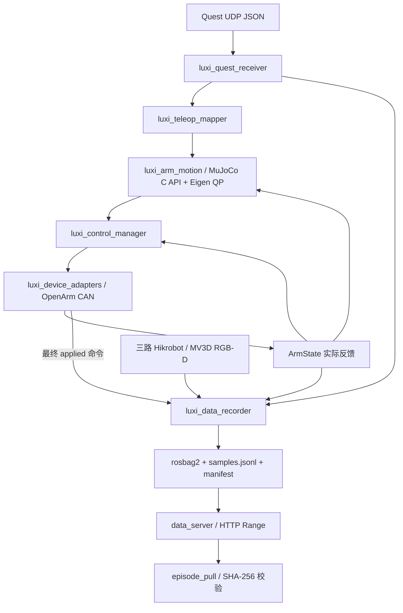

# C++ ROS 2 实现与接口

## 包与数据流

各设备只有一个控制出口。R680 三轮全向底盘已作为可选 C++ 节点接入，见 [R680 说明](../device/R680/README.md)。本阶段 Lift 协议和训练均不实现；KH-UCANFD-B2B-X4 已通过厂商 kcan + SocketCAN 接入（见 device 中的适配说明），不创建看似可运行的空驱动。新增设备以后扩展 robot_interfaces 和对应适配器。

| 路径 | 包 | 内容 |
| --- | --- | --- |
| Project/robot_interfaces | luxi_interfaces | QuestInput、ArmTargets、ArmCommand、ArmState、CameraFrame、Command 服务 |
| Project/robot_core | luxi_core | 数据校验、时间判断、坐标变换、One Euro 平滑、公共配置和限幅 |
| Project/quest_receiver | luxi_quest_receiver | 单一 UDP owner、源 IP 可选限制、实际新包接收、去重复、拒绝畸形输入 |
| Project/teleop_mapper | luxi_teleop_mapper | Unity 左手系→参考姿态→arm_origin；平滑；夹爪映射 |
| Project/arm_motion | luxi_arm_motion | 实测关节同步、33 ms 定时、二子步受限 QP IK |
| Project/control_manager | luxi_control_manager | 默认 disabled、homing、aligning、teleop、hold、returning、fault |
| Project/device_adapters | luxi_device_adapters | 真/假 OpenArm、真/假海康、可选 R680 全向底盘；独立反馈与最终命令 |
| Project/data_recorder | luxi_data_recorder | 原始 rosbag、可读采样索引、episode 管理、网页、下载与接收 |
| Project/robot_description | luxi_description | 固定版本 OpenArm MJCF 与帧约定，不编造尚未标定相机外参 |
| Project/robot_bringup | luxi_bringup | XML launch、旧机配置迁移、C++ 集成测试 |

## 消息与单位

- `/luxi/quest`：来自每个真实接受报文；记录 Quest sender_time 与板端 receive_mono_ns。重复或倒序发端时间在活动会话被拒绝；断流一秒后允许应用重启时钟。当前老 APK 无显式 session_id/seq，板端 sequence 仅用于接收流，不能证明 Wi-Fi 完全无丢包。
- `/luxi/targets`：末端目标以 arm_origin 表示；valid 数组顺序 right、left。夹爪也是 right、left。
- `/luxi/intent`：IK 输出；不能当实际执行反馈。
- `/luxi/command`：整机管理器最终目标，带阶段及命令期限依据。
- `/luxi/applied`：适配器限幅并提交 SDK 之后的目标；header 是提交后主机时间。表示发送成功，不表示硬件 ACK 或已经到位。
- `/luxi/arms/state`：right[8],left[8]；位置 rad、速度 rad/s、力矩为 SDK 原单位；含温度、每电机年龄与有效性。驱动未使能时仍持续采集反馈。
- `/luxi/cameras/{head_rgb,left_wrist_rgb,right_wrist_rgb}`：JPEG payload、尺寸、设备原始时间、接收单调时间、帧号、时间质量。另发标准 CompressedImage 便于 ROS 客户端使用。
- `/luxi/control`：Command 服务；start / stop / disable。start 要求新鲜反馈、有效 Quest 追踪和过去一秒至少 50 个接受报文。
- `/luxi/episode`：Command 服务；start / success / fail / cancel。detail 用于任务文本或失败原因。

同机单调时钟用于超时；ROS header 用于跨工具记录。不同机器单调时钟不能直接相减；HTTP 客户端保留原始时钟信息。当前相机 header 是主机取帧时刻，设备时钟未映射，不称硬件同步。

## 相比旧实现的明确变化

1. 去除 Dora 和 Python 业务运行时。原 `mink` Python 优化器替换为 Eigen 的严格凸、箱约束阻尼最小二乘 QP（循环坐标下降），通过 MuJoCo 计算雅可比；不是数值逐位等价迁移。使用实测关节同步、关节/速度限制与姿态正则。复杂碰撞检测不在本实现中。
2. 保留固定 `arm_origin`、Unity 变换、夹爪符号、原配置起止姿态和慢速对齐。滤波旋转采用四元数 slerp，参数与旧版接近，仍需实机体验标定。
3. 真 UDP 断流或 INVALID 后保持，不能用新发布时间为旧包续命；不会自动解除 hold。旧版追踪门禁缺陷不迁移。
4. 录制 action 从 IK 前端移到最后下发层；夹爪仍经过旧驱动相同的关节物理限幅。例如右侧输入 -1，实际限幅可能为 -0.4；二者分别保存在 intent 与 applied。
5. 原始格式改为 ROS 2 原生 rosbag2 SQLite，加逐采样 JSONL 和完整 manifest；不输出旧 Dora Parquet，也不执行 LeRobot 转换、训练、ACT/SmolVLA 推理。
6. 原始全频流全部记录。samples 是简明索引视图：最多约 30 Hz，以有界缓存（64 条状态、每相机 16 帧）选择发送时刻之前已到达的最近实测状态与三图；丢失/过期观察不伪造、原始 rosbag 仍保留。任务质量要求应结合真实时延进一步标定。
7. 三相机尺寸目前仍是主机缩放，不承诺降低 USB 输入带宽。设备曝光/触发配置需由后续真实 SDK 资料确认。

## 持久化与回传

每次录制产生 `.partial-episode-<ROS时间>/`。rosbag 持续写入，样本按行增量保存；停止后关闭 rosbag、刷盘、计算文件 SHA-256、写 manifest，最后重命名提交。取消与失败同样保留数据，只有通过质量检查的成功 episode 标 accepted。异常中断目录保留，不自动并入接受数据。

目录包含 session.json、robot_config.json、bag/*.db3、bag/metadata.yaml、samples.jsonl、manifest.json。session 记录顺序、单位、任务和时钟域；相机元数据随每帧保存在 bag 中。未闭合的 bag 可以在离线确认后用 rosbag2 的 reindex/恢复工具处理，不自动更改事故原始数据。

HTTP 默认 127.0.0.1:8000。`/api/state` 提供状态，`/api/cameras/<name>` 提供 JPEG 和 frame/time 响应头，`/api/episodes` 列出已提交 episode，`/api/episodes/<id>/manifest` 提供完整清单，`/api/files/<id>/<file>` 只允许 manifest 中的文件并支持 Range。不是基于预览图抓取训练数据。

`episode_pull` 保留下载临时目录，重连从已有文件大小续传，全量哈希验证后提交。已经完成的 episode 不会静默覆盖。服务端不自动删除已传输文件；容量不足时停止并标记当前录制。

## 已知硬件验证边界

本地可以验证 C++ 编译、MuJoCo 数值、ROS 图、虚拟设备反馈、协议包装的假 SDK、录制、HTTP 和接收流程。mock 不证明真实 CAN、电机运动、海康曝光同步和 USB 长时稳定性。

海康实机库缺失时硬件模式明确失败，不自动退回假图。适配层按旧 Python ABI 迁移；取得正式 SDK 的头文件、ARM64 二进制和相机后仍应核对结构 ABI、相机工作模式、像素格式、设备时钟单位及 SDK 缓冲区生命周期。

OpenArm 真模式编译使用官方 1.3.4 库并带发送错误补丁，默认不打开 CAN。不会执行 CAN 设置、回零或写设备 EEPROM。实体使能只在显式启动硬件模式且通过控制服务/按钮请求后发生。
