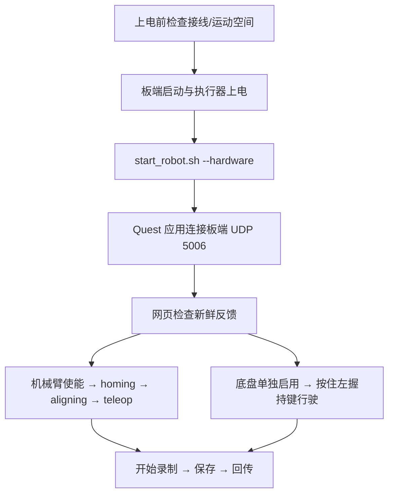

# 上电启动与 Quest 操作指南

> 2026-09-15：X 仅控制双臂、Y 切换底盘许可及取消录制解绑已构建并通过隔离软件测试。未重启实机服务，新映射随底盘适配器和录制器下次启动生效；实机按键验证仍待现场操作。详见 [测试记录](Quest_button_mapping_validation_20260915.md)。

适用当前代码：RDK 主机、KH-UCANFD-B2B-X4、双 OpenArm、R680 三轮全向底盘。升降平台尚未接入。程序负责遥操作、录制与局域网回传，不进行训练。

> 更新：网页启动时现已自动启动独立 Quest 接收服务（UDP 5006），不依赖 CAN；无需另开接收终端。

> 新增：可安装局域网网页开机服务，详见 [Web 控制台与开机自启](../Project/luxi_web_ctrl/README.md)。安装后从其他电脑访问 `http://板端IP:8000`；下文原快捷指令仍可用，并自动复用已运行的网页服务。

## 1. 一条指令启动

**首次实车操作之前，请先完成下文接线、车型、运动空间与急停检查。** 在板载电脑普通用户终端执行以下一整行；可从任意目录运行：

```bash
/home/sunrise/Desktop/LUXI_Lift_Robot/luxi_lift_ros2/lift_robot_ros2/tool/start_robot.sh --hardware
```

脚本会按顺序执行：检查已有程序/端口 → 检查内核模块版本与 USB 设备 → 必要时加载 kcan → 按固定通道身份配置 CAN → 启动 ROS 2 节点。需要时终端会提示输入 sudo 密码；不需要用 sudo 启动整个脚本。

**这条实机指令启动真实双臂和底盘，默认关闭相机。** 当前海康 SDK 尚待实机核对，不能将无图像录制当作完整视觉数据。脚本不会自动使能机械臂或底盘运动，但底盘节点会周期发送零速，机械臂节点会配置/查询反馈；上电本身还可能触发 STM32 自检。

只想演练流程、验证 Quest 网络与网页时，使用模拟模式：

```bash
/home/sunrise/Desktop/LUXI_Lift_Robot/luxi_lift_ros2/lift_robot_ros2/tool/start_robot.sh --mock
```

若已运行开机网页服务，模拟快捷启动自动使用隔离的 ROS 域 76、网页端口 18000 和 Quest UDP 15006，实机网页仍保留在 8000。

模拟模式包含双臂、底盘和三路假相机，**不会打开实物 CAN**，数据明确属于 mock。无参数运行也默认为 mock。

只检查启动条件，不加载模块、不改 CAN、不启动节点：

```bash
/home/sunrise/Desktop/LUXI_Lift_Robot/luxi_lift_ros2/lift_robot_ros2/tool/start_robot.sh --hardware --check
```

此检查不证明接线、电机反馈或实际运动正确。脚本拒绝已有控制节点或 UDP 5006/TCP 8000 被占用的情况；先正常停止旧程序。不要在另一终端同时启动原 Dora/PS2/APP 控制流程。

## 2. 第一次准备；以后上电通常无需重复

```bash
cd /home/sunrise/Desktop/LUXI_Lift_Robot/luxi_lift_ros2/lift_robot_ros2
./tool/build.sh
./tool/build_kh_driver.sh
./tool/test.sh
```

当前主机此前已完成构建。只有修改源码、清理 build 或更换内核后才需要重新构建；内核升级必须重编 kcan。系统软件依赖见 [仓库 README](../README.md)。产物在 `build/`，日志在 `log/`，外部 SDK 不使用 Git 子模块。

Quest 端需预先安装并运行原项目配套的遥操作发送应用（APK），使其发送当前 JSON 格式。**板端启动脚本不会自动启动头显应用，也不会替你安装 APK。** 当前仓库未包含 APK 安装文件，不能保证某个固定应用名称或按钮布局；使用你们已有的配套应用。仅打开 Quest 浏览器或完成头显 Wi-Fi 连接不会产生遥操作报文。

## 3. 接线和上电顺序

| KH 外壳通道 | 稳定接口名 | 连接对象 | 总线设置 |
|---|---|---|---|
| CH1 | luxi_left | 左 OpenArm | CAN FD，仲裁 1M / 数据 5M |
| CH2 | luxi_right | 右 OpenArm | CAN FD，仲裁 1M / 数据 5M |
| CH3 | luxi_base | R680 全向底盘 | **经典 CAN 1M，FD 关闭** |
| CH4 | luxi_lift | 后续升降平台 | 当前关闭 |

确认电机固件速率与配置一致；`can0` 是板载 SPI CAN，不代表 KH 的 CH1。一键脚本使用 `arms-kh.json` 与 `device/R680/channels-r680.json`，不要套用旧 right=can1、left=can2 的编号关系。

1. 断电检查 CAN H/L、信号地、供电和终端电阻，连接 KH USB；实车必须运行 R680 的 OMNI_CAR 固件。
2. 确保双臂回起始姿态的路径无遮挡。首次底盘方向测试将车轮架空，独立急停可操作、现场有人看护。STM32 源码有上电自检运动，不能把“ROS 默认 disabled”理解为整机上电绝不会动作。
3. 给板载电脑和外设供电，等待系统启动；按设备要求给执行器供电，检查故障与急停状态。
4. 执行上方 `start_robot.sh --hardware`，保持该终端打开。
5. 在**板载电脑本机浏览器**打开 `http://127.0.0.1:8000`。这时机械臂/底盘默认尚未获得非零运动许可。



## 4. 打开 Quest 应用并建立连接

1. Quest 与板载电脑连接同一局域网；无线 AP 不应开启阻断两设备互访的客户端隔离。
2. 在板端终端查看 IP：

   ```bash
   ip -4 addr show wlan0
   ```

   找到 `inet` 后的 IPv4 地址，例如 `192.168.1.50`。如果使用其他网卡，执行 `ip -4 addr` 找对应地址。不要把示例 IP、`127.0.0.1` 或网关地址填入头显。
3. 戴上 Quest、唤醒两个手柄，打开已安装的配套遥操作应用。在其目标主机/地址设置中填写**板端 IPv4**，目标 UDP 端口填写 **5006**，启动应用的数据发送功能。实际菜单名称以你们 APK 为准。
4. 保持应用在前台，确认头显和两个手柄追踪正常。应用应发送位姿、`lt/rt`、`lg`、`lsx/lsy/rsx/rsy`、A/B/X/Y 与追踪标记。`lg` 缺失时视为握持键松开；仅 `require_left_grip=true` 的启动模式需要该键行驶，托管模式不要求握持。
5. 等待一两秒，在网页状态中确认 `control.vr_fresh=true`，机械臂 `arms.valid` 全部为 true；底盘应有 `base.valid=true`、`base_status.feedback_fresh=true`、`flag_stop=0`。

机械臂启动还要求过去一秒至少收到 50 个有效 Quest 报文。不要仅凭 IP 可 ping 通就判定遥操作已连接。必要时在另一个板端终端检查：

```bash
cd /home/sunrise/Desktop/LUXI_Lift_Robot/luxi_lift_ros2/lift_robot_ros2
source /opt/ros/humble/setup.bash
source build/install/setup.bash
ros2 topic hz /luxi/quest
```

诊断终端与启动终端应使用相同的 `ROS_DOMAIN_ID`/网络设置；正常启动沿用当前环境默认值，自动测试的域 73/74 不要混用到另一终端。

## 5. 开启机械臂控制

1. **先保持左握持键松开，暂不启用底盘。** 双臂追踪和实际关节反馈正常后，长按左手柄 **X 约 1.5 秒**，或在网页点击“使能双臂”。
2. 状态进入 `homing`，机械臂会向 `arms-kh.json` 中配置的起始姿态运动；这不是电机零点标定，不会自动修正错误的机械安装零位。
3. 到达起始姿态后进入 `aligning`。将两个手柄保持在合适姿态，按住对应食指扳机至接近全按下（>0.92），允许该侧机械臂慢速对齐。对齐过程中手柄不要突然移动。
4. 等待 `control.phase=teleop`，再缓慢移动手柄控制末端；食指扳机控制对应夹爪开合。
5. 短按 X 或网页“暂停 / 返回”会进入 `returning`，双臂返回起始姿态后 `disabled`。**此按钮包含返回运动，不是硬件急停。** 危险情况使用设备独立急停。

断流或追踪无效后可能进入 `hold`，网络恢复不会自动继续。先恢复连接，正常暂停并等待 `disabled`，再使能和对齐；底盘也需重新单独启用。

## 6. 开启底盘控制

底盘许可与双臂许可独立。X 仅控制双臂，短按、长按及松开都不会启用、停车或撤销底盘许可；底盘启用/停用用 Y。

1. 保持摇杆回中，关闭录制失败菜单。确认 Quest 与底盘反馈新鲜且 `FlagStop=0`。托管模式无需按握持键；独立启动默认 `require_left_grip=true` 时启用前松开左握持键。
2. 短按 Y，或网页点击“启用 Quest 底盘控制”，确认底盘状态变为已启用。Y 长按不重复切换；启用被拒绝或断线恢复后，需松开 Y 再按。若从终端操作：

   ```bash
   ros2 service call /luxi/base/control luxi_interfaces/srv/Command "{command: start, detail: ''}"
   ```
3. 托管模式启用后直接操作摇杆，两侧中指握持键预留给未来升降。独立启动且 `require_left_grip=true` 时，仍需按住左侧握持键（`lg≥0.7`，不是食指扳机）。

| 输入 | 动作 |
|---|---|
| 左摇杆前推 / 后拉 | 前进 / 后退 |
| 左摇杆左拨 / 右拨 | 左移 / 右移 |
| 右摇杆左拨 / 右拨 | 静止或前进时逆时针 / 顺时针转向 |
| 右摇杆上下 | 当前无动作 |
| 摇杆回中 | 立即下发零速，保留底盘许可 |
| 短按 Y | 未启用时请求启用；已启用时停车并撤销许可 |
| 网页“底盘停车”或按 B | 撤销底盘运动许可，重新行驶需再次启用；同时按 Y 时仍停车优先 |
| 松开左握持键（仅 `require_left_grip=true`） | 立即下发零速 |

**倒车转向采用原 PS2 逻辑：倒车时左右转向符号反转。** 如需始终按车体固定方向转向，完成 CAN 初始化后用 `tool/run.sh` 并传入 `base_ps2_reverse_steering:=false`，见 R680 文档。快捷启动当前采用默认 PS2 行为。

默认平移上限 0.2 m/s，转向上限约 0.314 rad/s。左摇杆上下在失败原因菜单中用来选项；打开该菜单会撤销底盘许可，避免冲突。Quest 超时 200 ms、底盘反馈失联等情况会持续下发零速并撤销许可；线路断开或主机断电时不保证零速能够送达。

## 7. 录制与保存

1. 先完成双臂对齐进入 teleop；需要底盘运动时再单独启用底盘。
2. 在网页填写任务说明，点击“开始录制”；也可短按 A。使用 A 时采用录制器的任务名称，网页输入框文字不会自动同步到 Quest 按键。
3. 完成后点击“成功并保存”，或再次短按 A；失败时使用网页“失败并保存”，或 B 打开原因菜单、左摇杆上下选择、A 确认。取消请点击网页“取消本次并保留数据”。Y 专用于底盘启用/停用，长按也不会取消录制。
4. 确认 recorder.state 回到 `idle`，检查生成的 manifest 状态和质量检查结果。点击成功并不代表质量检查一定得到 accepted。

快捷启动的数据位置：

| 模式 | 保存目录 |
|---|---|
| `start_robot.sh --hardware` | `data/real/episode-*` |
| `start_robot.sh --mock` | `data/mock/episode-*` |
| 直接运行原 `tool/run.sh` | 默认 `data/episode-*` |

每个 episode 包含 bag、samples.jsonl、配置和 manifest。底盘四个 `/luxi/base/*` 话题也写入 bag。双臂索引暂为 16 维，升降尚未接入；底盘异步反馈保存在独立话题中。

**实机快捷启动关闭相机、允许无图像录制。** 要采集三路视觉数据，请先完成下一节。默认真实录制预留 20 GiB 空间，不足时拒绝开始；模拟快捷启动预留 0.2 GiB。mock 数据不可混入实机数据。

## 8. 海康三相机接入后如何启动

先安装与现有 ABI 对应的 ARM64 `MV3D_RGBD_*` SDK，核对三台相机序列号和设备模式；具体见 [迁移说明](CPP迁移与接口说明.md)。下面命令要求 CAN 已由快捷启动配置好、旧程序已正常停止：

```bash
cd /home/sunrise/Desktop/LUXI_Lift_Robot/luxi_lift_ros2/lift_robot_ros2
export LD_LIBRARY_PATH="$PWD/device/sdk/hikrobot:${LD_LIBRARY_PATH:-}"
./tool/run.sh mock:=false allow_hardware:=true base_enabled:=true \
  "config:=$PWD/Project/robot_bringup/config/arms-kh.json" \
  "sdk_library:=$PWD/device/sdk/hikrobot/libMv3dRgbd.so" \
  no_cameras:=false require_cameras:=true "directory:=$PWD/data/real"
```

三路图像均正常刷新后才开始录制。源码中当前序列号为：头部 `00DA8573794`、左腕 `00DB1265540`、右腕 `00DA8573792`。实物不一致时修改 launch 配置并重新构建。当前图像时间戳主要是主机取帧时间，不代表已经完成三相机硬件曝光同步。

## 9. 局域网访问与回传

快捷启动的网页只监听板端 `127.0.0.1:8000`。Quest UDP 接收不受这个 HTTP 地址限制。要从另一台电脑看网页，可在 CAN 已配置、旧程序已退出后使用：

```bash
cd /home/sunrise/Desktop/LUXI_Lift_Robot/luxi_lift_ros2/lift_robot_ros2
./tool/run.sh mock:=false allow_hardware:=true base_enabled:=true \
  "config:=$PWD/Project/robot_bringup/config/arms-kh.json" \
  no_cameras:=true require_cameras:=false "directory:=$PWD/data/real" http_host:=0.0.0.0
```

另一台电脑打开 `http://板端IP:8000`，无需密码或令牌，设备就绪后即可操作。能够访问此地址的客户端都能提交控制请求；电机仍需显式使能。

接收电脑需装好本项目接收工具和相应依赖；从网页 episode 列表获取实际编号后执行：

```bash
ros2 run luxi_data_recorder episode_pull http://板端IP:8000 episode-实际编号 /接收目录
```

工具支持续传并校验 SHA-256，不会自动删除板端原始数据。仅回传文件不涉及训练。

## 10. 正常停止和下电

1. 松开左握持键，点击“底盘停车”。
2. 完成/取消当前录制，等待 recorder.state 为 idle，文件落盘完成。
3. 确保返回路径安全，点击“暂停 / 返回”或短按 X，等待机械臂 `disabled`。
4. 在启动程序的终端按 Ctrl+C，等待各节点退出。底盘正常退出会尝试连续发送 10 帧零速；这不能代替硬件停车验证。
5. 需要时关闭 CAN 接口：

   ```bash
   cd /home/sunrise/Desktop/LUXI_Lift_Robot/luxi_lift_ros2/lift_robot_ros2
   sudo build/install/luxi_device_adapters/lib/luxi_device_adapters/kh_can_setup device/R680/channels-r680.json --down
   ```

6. 按设备要求切断执行器电源，再正常关闭板载电脑。不要在录制尚未提交时直接断电；异常留下的 `.partial-*` 目录应保留排查。

## 11. 常见问题

| 现象 | 检查与处理 |
|---|---|
| 提示端口/节点占用 | 停止原程序；不要重复运行一键脚本或同时运行原 Dora |
| 提示内核版本不匹配 | 重跑 `tool/build_kh_driver.sh`，不要强制加载旧 .ko |
| 看不到 KH | 查 USB 连接、供电、`lsusb -d 395e:0020` |
| Quest 没数据 | 查 APK 是否正在发送、目标是否板端 IP、端口 5006、AP 隔离及防火墙 |
| 机械臂使能失败 | 查实际反馈有效性、过去一秒 Quest 包数、状态是否 disabled |
| 停在 aligning | 检查对应食指扳机是否全按、目标是否可达及关节配置 |
| 底盘启用失败 | 摇杆回中、左握持键松开、菜单关闭、反馈新鲜且 FlagStop=0 |
| 启用后底盘不走 | 查左握持键 lg 是否发送且≥0.7；不要按成食指扳机 |
| 底盘 CAN 启动报 MTU 错误 | CH3 必须是经典 CAN，fd off，不能用左右臂 FD 配置 |
| 底盘 FlagStop 非 0 | 检查设备急停/失能/故障；协议没有主机远程清除此标志的指令 |
| 实机网页没有图像 | 快捷实机模式主动关闭相机；按第 8 节配置正式 SDK |
| 开始录制失败 | 查双臂反馈/使能、相机要求、磁盘剩余空间及已有录制状态 |

本指南依据本地源码与已完成的软件/虚拟 CAN 测试。真实机械臂运动、底盘方向、实际停车和海康相机仍需现场验收，参见 [R680 验证记录](R680编译与测试记录.md)。

启动脚本验证（2026-09-10）：Shell 语法检查、mock 启动预检、完整 mock 节点启动、HTTP 状态读取与正常退出通过；双臂/底盘初始 disabled、录制器 idle。日志在 `log/startup-mock-smoke.log`。本次实机预检提示未检测到 KH USB 设备，因此未执行真实 CAN 配置和运动测试。
